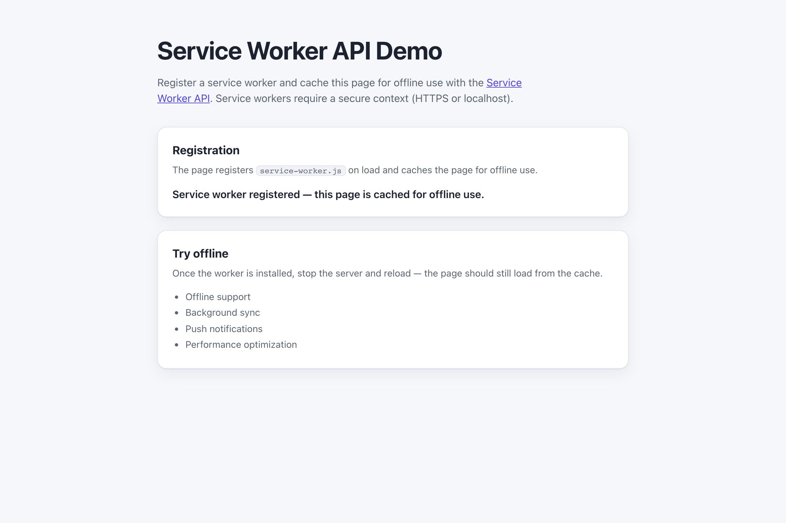

# WebSharper.ServiceWorker

[](https://github.com/dotnet-websharper/ServiceWorker)

WebSharper bindings for the [Service Worker API](https://developer.mozilla.org/en-US/docs/Web/API/Service_Worker_API) —
registering a service worker, caching assets, and communicating with the page from F# and C# web apps.

Service workers require a [secure context](https://developer.mozilla.org/en-US/docs/Web/Security/Defenses/Secure_Contexts)
(HTTPS or localhost), so the sample only registers its worker when the page is served from a secure origin.

This repository contains:

| Project | Purpose |
| --- | --- |
| `WebSharper.ServiceWorker` | The binding: WIG definitions for `ServiceWorker`, `ServiceWorkerRegistration`, `ServiceWorkerContainer`, `ServiceWorkerGlobalScope`, `Cache`, `CacheStorage`, `ExtendableEvent`, `FetchEvent`, `ExtendableMessageEvent`, `Client`, `WindowClient`, and their option dictionaries. |
| `WebSharper.ServiceWorker.Extensions` | `[<Inline>]` client extensions: `navigator.serviceWorker`, `window.caches`, and `workerGlobalScope.caches`. |
| `WebSharper.ServiceWorker.Sample` | An ASP.NET Core SPA that registers a service worker and caches the page for offline use. |

## Live demos

**Try it live:** [Open the sample in your browser](https://dotnet-websharper.github.io/ServiceWorker/)



The sample doubles as the binding's test case: it registers the service worker and reports the registration status in the page.

- **Sample (this repository):** <https://dotnet-websharper.github.io/ServiceWorker/>
- **Source repository:** <https://github.com/dotnet-websharper/ServiceWorker>
- **WebSharper bindings:** <https://websharper.com/bindings>

## Features

- `ServiceWorker` (`scriptURL`, `state`, `postMessage`, `onstatechange`, `onerror`).
- `ServiceWorkerRegistration` (`active`, `installing`, `waiting`, `scope`, `update`, `unregister`, `getNotifications`, `showNotification`, `navigationPreload`).
- `ServiceWorkerContainer` (`register`, `getRegistration`, `getRegistrations`, `ready`, `controller`, `startMessages`, and the message events).
- `ServiceWorkerGlobalScope` (`clients`, `registration`, `serviceWorker`, `skipWaiting`, and the install/activate/fetch/message/push/notification event hooks).
- `Cache` and `CacheStorage` (`open`, `add`, `addAll`, `match`, `matchAll`, `put`, `delete`, `keys`).
- `ExtendableEvent`, `FetchEvent`, `ExtendableMessageEvent`, `Client`, `WindowClient`, and their option dictionaries.
- `navigator.serviceWorker`, `window.caches`, and `workerGlobalScope.caches` in the Extensions assembly.

## Installation

The binding is not currently published to NuGet. Reference the projects from source:

```bash
git clone https://github.com/dotnet-websharper/ServiceWorker.git
```

```xml
<ItemGroup>
  <ProjectReference Include="path/to/WebSharper.ServiceWorker/WebSharper.ServiceWorker.fsproj" />
  <ProjectReference Include="path/to/WebSharper.ServiceWorker.Extensions/WebSharper.ServiceWorker.Extensions.fsproj" />
</ItemGroup>
```

## Usage

```fsharp
namespace WebSharper.ServiceWorker.Demo

open WebSharper
open WebSharper.JavaScript
open WebSharper.ServiceWorker

[<JavaScript>]
module Demo =
    let register () =
        JS.Window.Navigator.ServiceWorker.Register("service-worker.js")
            .Then(fun _ -> Console.Log("Service worker registered."))
            .Catch(fun error -> Console.Error(error))

    let openCache () =
        promise {
            let! cache = JS.Window.Caches.Open("my-cache")
            do! cache.AddAll([| "/"; "/index.html" |])
            return ()
        }
```

The `serviceWorker` and `caches` accessors are declared in the Extensions assembly and hang off
`JS.Window.Navigator`, `JS.Window`, and `WorkerGlobalScope`. Register a worker script, then use the
`Cache` / `CacheStorage` types to cache requests and responses.

## Running the sample

Build the sample in Release and serve its static output:

```bash
dotnet build WebSharper.ServiceWorker.Sample/WebSharper.ServiceWorker.Sample.fsproj -c Release
python3 -m http.server -d WebSharper.ServiceWorker.Sample/wwwroot 8099
```

Open <http://localhost:8099/>. Localhost counts as a secure context, so the service worker registers.

Alternatively, run the ASP.NET Core host:

```bash
dotnet run --project WebSharper.ServiceWorker.Sample
```

## Building from source

### Prerequisites

- [.NET SDK 10](https://dotnet.microsoft.com/download) or later.

### Build

```bash
dotnet build WebSharper.ServiceWorker.sln -c Release
```

The binding projects target `netstandard2.0`; the sample targets `net10.0`.

## Deployment

Pushing to `main` triggers `.github/workflows/ghpages.yml`, which builds the sample in Release and publishes
`WebSharper.ServiceWorker.Sample/wwwroot` to the `gh-pages` branch.

## Repository layout

```
WebSharper.ServiceWorker/              # binding (WIG definitions)
  Main.fs
WebSharper.ServiceWorker.Extensions/   # [<Inline>] client extensions
  Library.fs
WebSharper.ServiceWorker.Sample/       # ASP.NET Core SPA demo
  Client.fs
  Startup.fs
  wwwroot/
    index.html
    service-worker.js
    site.css
.github/workflows/ghpages.yml      # build + deploy the sample to GitHub Pages
```

## Notes on the API

- **Secure context:** service workers are only available in secure contexts. Serve the page over HTTPS or from localhost.
- **Scope:** `register()` returns a `Promise<ServiceWorkerRegistration>`; the worker's scope defaults to the script's directory.
- **Lifecycle:** the `install`, `activate`, and `fetch` events are handled in the worker script. `ExtendableEvent.waitUntil()` keeps the event alive while the work completes.
- **Caching:** `CacheStorage.open()` returns a `Cache`; use `addAll()` / `put()` to store requests and `match()` to serve them from the worker.
- **Updates:** call `registration.update()` to check for a new worker script; `skipWaiting()` and `clients.claim()` take control immediately.

## License

Apache 2.0 — see [LICENSE.md](LICENSE.md).
